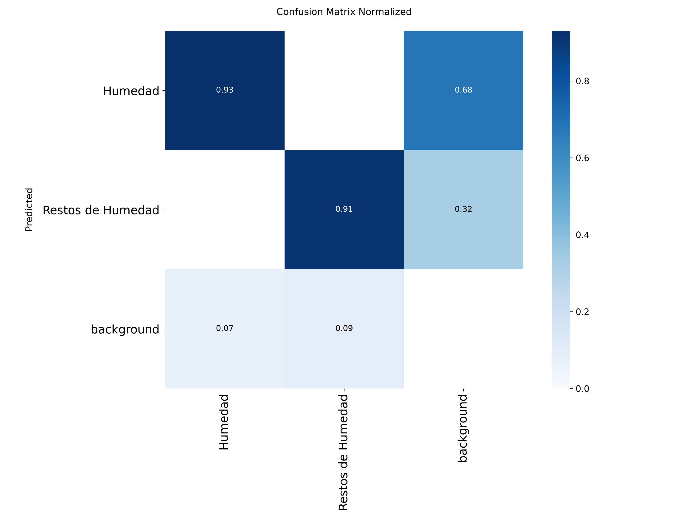
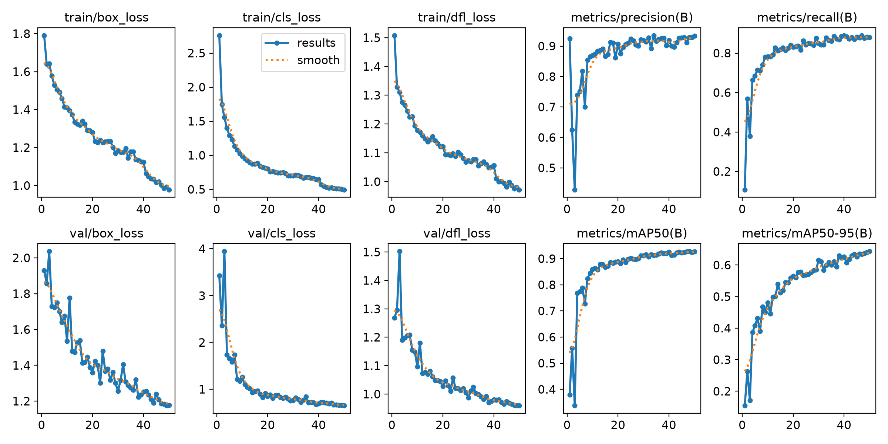
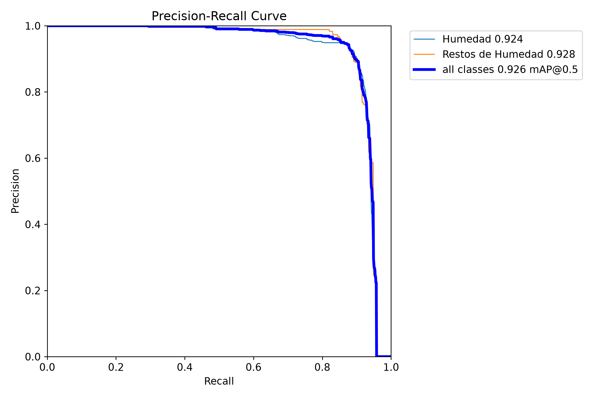
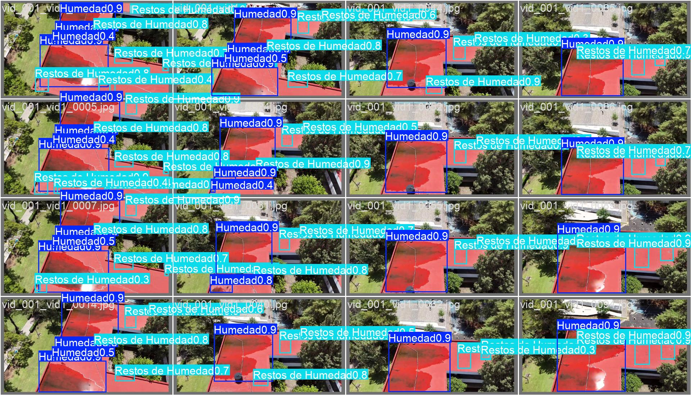

# Deteccion Automatica de Patologias por Humedad en Edificaciones mediante YOLOv8 e Imagenes de Dron

Sistema de vision por computadora basado en aprendizaje profundo para la inspeccion, deteccion y clasificacion automatica de patologias asociadas a humedad en azoteas y fachadas de edificaciones patrimoniales y modernas.

El proyecto diferencia entre dos categorias diagnosticas con implicaciones de mantenimiento diferenciadas:
- Humedad Activa (Clase 0): Filtracion o acumulacion de agua en estado activo que requiere atencion correctiva prioritaria.
- Restos de Humedad / Humedad Inactiva (Clase 1): Manchas secas o marcas residuales que indican afectaciones previas o zonas de riesgo recurrente.

Trabajo de investigacion desarrollado en el marco del XXIX Verano de la Investigacion Cientifica y Tecnologica del Pacifico (Programa Delfin), en colaboracion entre el Instituto Tecnologico de Morelia (ITM) y la Universidad Michoacana de San Nicolas de Hidalgo (UMSNH - Facultades de Ingenieria Civil e Ingenieria Electrica). Presentado en el Encuentro de Jovenes Investigadores del Estado de Michoacan (EJIEM 2026).

---

## Documentacion y Evidencia Academica

Los documentos de respaldo cientifico y de divulgacion se encuentran organizados en la carpeta `docs/`:

- Articulo de investigacion (EJIEM 2026):
  - [Lectura directa en PDF](docs/articulo_investigacion_ejiem.pdf)
  - [Formato editable DOCX](docs/articulo_investigacion_ejiem.docx)
- Presentacion ejecutiva del proyecto:
  - [Diapositivas en PDF](docs/presentacion_delfin.pdf)
  - [Presentacion con video PPTX](docs/presentacion_delfin.pptx)

Consulte la [guia de documentacion](docs/README.md) para conocer detalles sobre las ponencias e instituciones participantes.

---

## Metodologia

```
  Vuelo de Dron (Video 4K / 1080p a 30 fps)
                     |
                     v
   Extraccion y filtrado de fotogramas (OpenCV a 15 fps)
                     |
                     v
   Etiquetado manual en formato YOLO (LabelImg)
     - Clase 0: Humedad Activa
     - Clase 1: Restos de Humedad / Inactiva
                     |
                     v
   Entrenamiento YOLOv8n (PyTorch + CUDA en NVIDIA RTX 4050)
     - Optimizacion de ganancia de perdida de clasificacion (cls=1.5)
     - Resolucion de entrada: 640x640, 50 epocas
                     |
                     v
   Evaluacion en Videos de Campo Independientes
```

1. Adquisicion de datos: Grabacion en campo con dron sobre cubiertas de edificios historicos y contemporaneos del campus universitario, bajo diferentes condiciones solares, angulos de inclinacion y rugosidades de material.
2. Procesamiento de imagenes: Reduccion de redundancia mediante muestreo a 15 fps con OpenCV (`video_to_images.py`).
3. Anotacion: Etiquetado de regiones delimitadoras (bounding boxes) en formato estandar YOLO con LabelImg.
4. Modelado y entrenamiento: Fine-tuning de YOLOv8n supervisado, ajustando hiperparametros de perdida para compensar el desbalance de clases y asegurar alta sensibilidad en bordes tenues de humedad pasiva.
5. Inferencia interactiva: Pipeline de analisis sobre secuencias de video (`2_analizar_video.py`) con trazado de umbrales independientes por clase.

---

## Resultados y Metricas de Evaluacion

El modelo final (YOLOv8n entrenado durante 50 epocas) demostro excelente capacidad de generalizacion y discriminacion entre ambas manifestaciones:

| Metrica | Valor Global | Humedad Activa (0) | Restos de Humedad (1) |
| :--- | :---: | :---: | :---: |
| Precision (P) | 93.4% | 93.2% | 93.6% |
| Exhaustividad / Recall (R) | 87.9% | 93.0% | 82.8% |
| mAP @ 0.50 | 92.6% | 92.4% | 92.8% |
| mAP @ 0.50:0.95 | 64.3% | 63.8% | 64.8% |

### Matriz de Confusion Normalizada

La matriz de confusion confirma que la confusion cruzada entre ambas categorias es practicamente nula, concentrandose los minimos residuos de error en falsos negativos contra fondo en condiciones de baja iluminacion:



### Curvas de Entrenamiento y Precision-Recall

Evolucion de perdidas de caja, distribucion focal y convergencia de mAP a lo largo de las 50 epocas:



Curva Precision-Recall (PR) por clase:



### Inferencia en Conjunto de Validacion

Muestras de prediccion automatica contrastadas con las etiquetas de campo:



---

## Estructura del Repositorio

```
.
├── 1_entrenar.py                # Pipeline de estructuracion de dataset y entrenamiento YOLOv8
├── 2_analizar_video.py          # Script interactivo de inferencia sobre videos de prueba
├── video_to_images.py           # Extractor de fotogramas desde videos fuente con OpenCV
├── requirements.txt             # Dependencias del entorno de Python
├── weights/
│   └── best.pt                  # Pesos optimizados del modelo final (6.2 MB)
├── assets/                      # Graficas de desempeno, matriz de confusion y evidencias
├── docs/                        # Articulo de investigacion (PDF/DOCX) y diapositivas
│   ├── articulo_investigacion_ejiem.pdf
│   ├── articulo_investigacion_ejiem.docx
│   ├── presentacion_delfin.pdf
│   ├── presentacion_delfin.pptx
│   └── README.md
├── Deteccion y Clasificacion de Humedad.../
│   └── Imagenes/                # Conjunto de imagenes y anotaciones YOLO por vuelo
└── Videos/                      # Directorio para depositar videos de prueba a procesar
```

---

## Instalacion y Requisitos

### Requisitos previos
- Python 3.9 o superior
- Tarjeta grafica compatible con CUDA (recomendado para entrenamiento, opcional para inferencia)

### Instalacion de dependencias
```bash
git clone https://github.com/msdiaz2109/deteccion-humedad-yolov8.git
cd deteccion-humedad-yolov8
pip install -r requirements.txt
```

---

## Guia de Uso

### 1. Extraccion de fotogramas a partir de video
Para procesar un nuevo video de dron y extraer imagenes para etiquetado:
```bash
python video_to_images.py
```
El script permite arrastrar el archivo de video o ingresar su ruta, seleccionando formato de imagen (JPG/PNG) y tasa de muestreo de fotogramas.

### 2. Entrenamiento del modelo
Para reorganizar el conjunto de datos balanceado y ejecutar el entrenamiento de 50 epocas:
```bash
python 1_entrenar.py
```
El script divide automaticamente las particiones de entrenamiento y validacion (80/20), genera el archivo de configuracion `dataset.yaml` y almacena las metricas generadas.

### 3. Inferencia y analisis interactivo en video
Para ejecutar el modelo sobre un video de inspeccion:
```bash
python 2_analizar_video.py
```
El sistema ofrece un menu interactivo para:
1. Seleccionar el modelo de pesos (`weights/best.pt` incluido por defecto o corridas en `runs/`).
2. Seleccionar el video depositado en `Videos/` o ingresar una ruta externa.
3. Generar el video delimitado en la carpeta de resultados, trazando:
   - Azul: Humedad Activa (umbral >= 0.20)
   - Rojo: Restos de Humedad (umbral sensible >= 0.12)

---

## Creditos y Agradecimientos

- Autores: M.S. Meneses Diaz, S. Alejos Soria, I. Luviano Soto, A. Raya Montano.
- Instituciones:
  - Instituto Tecnologico de Morelia (ITM).
  - Universidad Michoacana de San Nicolas de Hidalgo (UMSNH) - Facultad de Ingenieria Civil y Facultad de Ingenieria Electrica.
  - Programa Delfin (XXIX Verano de la Investigacion Cientifica y Tecnologica del Pacifico).
- Agradecimiento al Departamento de Topografia de la UMSNH por el apoyo tecnico y facilitacion de los equipos de vuelo para la adquisicion de datos.
